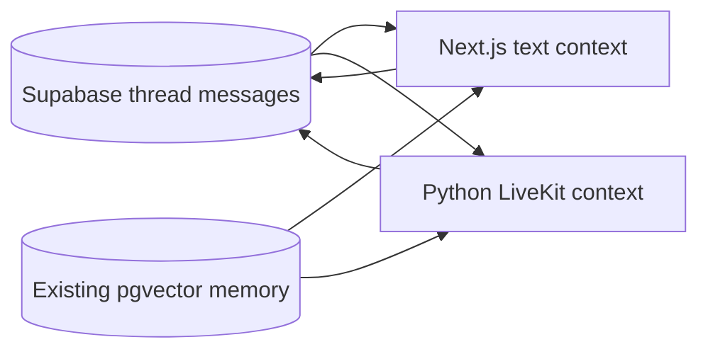

# Conversation context and stream recovery

Status: relational threads/messages and TanStack AI selected. The first
Sexyvoice migration is applied to isolated local Supabase, with generated types
and passing database tests. Runtime integration is pending. This extends the
[chat implementation plan](2026-11-16-chat-first-conversations-and-calls.md).
Production has not been changed.

## Requirements

- Text and voice continue the same character conversation.
- Save distinct threads so a future menu can reopen earlier conversations with
  that character. The menu itself is outside the first implementation.
- Allow one active text generation or voice call per user across characters,
  tabs, and devices. Saved threads can coexist.
- Resume interrupted text delivery without another generation or charge.
- Show `Thinking…` while waiting for the first visible answer text.
- Use the existing Supabase pgvector memory in text and voice, including durable
  fact extraction and the saved memory preference.

## What the current code stores

Sexyvoice's `call_sessions.transcript` is a JSONB call snapshot. Python's
[TranscriptCollector](https://github.com/gianpaj/sexycall/blob/23cac3548c49c7aeeeb1f59ac57da761908bdf34/src/transcript_collector.py) writes `messages`,
`user_transcriptions`, room name, and timestamps. Its in-memory utterance-ID map
deduplicates repeated user transcription events. Those IDs do not survive in
the saved message dictionaries; assistant messages also omit the SDK item ID
and interruption flag.

[SessionManager](https://github.com/gianpaj/sexycall/blob/23cac3548c49c7aeeeb1f59ac57da761908bdf34/src/session_manager.py) checkpoints the snapshot every ten
seconds and saves it during finalization. A new call's `chat_ctx` currently
receives preloaded memory, when enabled. It does not reload an earlier call's
verbatim transcript. Retained memory facts provide a different kind of continuity.

The existing [memory store](https://github.com/gianpaj/sexycall/blob/23cac3548c49c7aeeeb1f59ac57da761908bdf34/src/supabase_memory.py) preloads pinned and recent
slots, searches overflow with hybrid vector/full-text retrieval, and stores
shared user facts plus character relationships and episodes. Its
[extractor and verification pass](https://github.com/gianpaj/sexycall/blob/23cac3548c49c7aeeeb1f59ac57da761908bdf34/src/memory_extraction.py) check proposed
facts against the user's words. Call shutdown triggers extraction.

The reviewed local commits are Sexyvoice
`e0b3f076bb19b09adfbf8f7648db436e4f29fd40` and Sexycall
`23cac3548c49c7aeeeb1f59ac57da761908bdf34`.

## Findings from the supplied references

The reviewed Vercel commit is
`8ba3940d3dd1f3cd3c4365bbaec505c6ef0eb1e3`. The reviewed TanStack commit is
`22f7c73123ee02a39ed24e934a2ae872a7af2f29`. These are source snapshots, not a
claim that every API on `main` ships in an installed release.

| Reference                                                                                                                                          | Finding and consequence for Sexyvoice                                                                                                                                                                                                                |
| -------------------------------------------------------------------------------------------------------------------------------------------------- | ---------------------------------------------------------------------------------------------------------------------------------------------------------------------------------------------------------------------------------------------------- |
| [Vercel message layers](https://github.com/vercel/ai/blob/8ba3940d3dd1f3cd3c4365bbaec505c6ef0eb1e3/architecture/message-layers.md)                 | UI messages, model messages, standardized provider messages, and provider-specific requests have separate purposes. Save renderable conversation content and convert it for inference. Do not make an xAI request payload our database format.       |
| [TanStack chat persistence](https://github.com/TanStack/ai/blob/22f7c73123ee02a39ed24e934a2ae872a7af2f29/docs/persistence/chat-persistence.md)     | A stable thread contains many executions. Persist the accepted user turn before generation, and save the final transcript before declaring execution complete. Our wallet admission needs a transaction stronger than a best-effort middleware save. |
| [TanStack client persistence](https://github.com/TanStack/ai/blob/22f7c73123ee02a39ed24e934a2ae872a7af2f29/docs/persistence/client-persistence.md) | Server-owned history fits multiple devices and large transcripts. Hydration discovers the thread's active execution, then attaches to its stream. Browser storage is optional and cannot be the authority for history or billing.                    |
| [TanStack internals](https://github.com/TanStack/ai/blob/22f7c73123ee02a39ed24e934a2ae872a7af2f29/docs/persistence/internals.md)                   | Conversation persistence and stream delivery are separate. Authorization and concurrency remain application responsibilities. We need both a durable thread and a resumable transport.                                                               |
| [TanStack realtime chat](https://github.com/TanStack/ai/blob/22f7c73123ee02a39ed24e934a2ae872a7af2f29/docs/media/realtime-chat.md)                 | Its voice hook connects the browser directly to a provider. Connection state and listening/thinking/speaking state are separate. That hook would bypass our Python call backend; reuse the state distinction while retaining LiveKit.                |
| [TanStack resumable streams](https://github.com/TanStack/ai/blob/22f7c73123ee02a39ed24e934a2ae872a7af2f29/docs/resumable-streams/overview.md)      | A shared per-execution log can replay delivery without another provider call. The in-memory example is insufficient across processes. A surviving log does not itself continue a provider request after its producer dies.                           |

The implementation review exposed two details hidden by a quick reading of the
examples. TanStack's
[message-store contract](https://github.com/TanStack/ai/blob/22f7c73123ee02a39ed24e934a2ae872a7af2f29/packages/ai-persistence/src/types.ts#L90)
replaces the whole transcript. Its
[merge implementation](https://github.com/TanStack/ai/blob/22f7c73123ee02a39ed24e934a2ae872a7af2f29/packages/ai-persistence/src/merge-stored.ts)
can replace a matching stored message and cut off the stored tail. We must not
feed untrusted browser history into that behavior. Accept only a new user turn
and load authoritative history on the server.

TanStack's
[delivery contract](https://github.com/TanStack/ai/blob/22f7c73123ee02a39ed24e934a2ae872a7af2f29/packages/ai/src/stream-durability.ts#L10)
persists chunks before delivery and reads after an offset. Vercel's documented
[resume integration](https://ai-sdk.dev/docs/ai-sdk-ui/chatbot-resume-streams)
uses a different mechanism. In `resumable-stream` commit
`770cdeb4b6e4b3838b294b0565591f3d75930897`, the
[producer retains chunks in a local array](https://github.com/vercel/resumable-stream/blob/770cdeb4b6e4b3838b294b0565591f3d75930897/src/runtime.ts#L126)
and Redis Pub/Sub connects readers to it. Redis stores stream sentinels, rather
than a durable copy of every chunk. A producer crash loses that replay buffer.

## Selected storage

Use Supabase Postgres as the authority. Keep JSONB for each message's validated
parts; put message identity, order, and ownership in relational records.

| Record                                          | Minimum responsibility                                                                                                                                                                                                                               |
| ----------------------------------------------- | ---------------------------------------------------------------------------------------------------------------------------------------------------------------------------------------------------------------------------------------------------- |
| `conversations`                                 | Stable thread ID, owner, character reference and display-name snapshot, scene ID/instructions, language, timestamps, history revision. One thread can contain text and several calls.                                                                |
| `conversation_messages`                         | Stable thread-scoped message ID, explicit `position`, user/assistant role, chat/voice source, validated visible `parts` JSONB, state, revision, timestamps, and optional call/SDK item reference. An operation link follows with run admission.      |
| Operations/runs, later migration                | One accepted text generation or call, request ID/hash, history boundary, model/rate, wallet reservation, usage, settlement, and delivery-log reference. Map TanStack `runId` onto the same authority; do not maintain competing run/operation state. |
| Existing `call_sessions`                        | One call's timing, billing, diagnostics, and JSON transcript. The first migration adds an optional conversation link; an operation link follows with admission.                                                                                      |
| Existing `agent_memories`                       | Durable shared facts and character memories. Keep the current partitions and vector dimensions.                                                                                                                                                      |
| Per-run delivery log, later migration/adapter   | Shared append-before-delivery chunk log with ordered opaque offsets, terminal state, finite snapshots, and bounded retention. Distinct from saved history.                                                                                           |
| Memory work/checkpoint records, later migration | Durable extraction ranges, preference/deletion version, progress, and retry state. Coalesce work instead of extracting the entire thread after every message.                                                                                        |

Add indexes for owned conversations by character/activity, messages by thread
and sequence, and uniqueness of source call/item IDs. Use one per-user admission
guard for active operations. Do not add a unique owner/character constraint to
`conversations`; that would prevent future multiple threads with one character.
The idle browser does not hold an execution lock. Looking at saved history does
not create a model request. While an operation is active, keep its character
and scene fixed. Starting work with another character waits for that operation
to finish; navigation alone cannot silently replace the active call.

The message parts need only visible text in this release. A voice message holds
its transcript and source metadata. Store interruption state. Preserve typed
paragraphs and line breaks. Keep raw audio, internal instructions, memory
injections, provider reasoning, and transient `Thinking…` indicators out of the
visible message history. Additional content types need explicit adapters later.

Use the conversation ID as TanStack `threadId` and the message's durable ID as
`UIMessage.id`. Visible text parts use `{ type: "text", content: string }`.
Convert its text parts
and role into model messages for Next.js and into LiveKit `ChatContext` items for
Python. LiveKit's pinned
[ChatMessage and add_message APIs](https://github.com/livekit/agents/blob/296f28b0198dea71211f9a5e5cb8187292ab896a/livekit-agents/livekit/agents/llm/chat_context.py#L407)
support IDs and interruption state. Keep SDK source IDs separately for deduplication.

Keep legacy JSON transcripts and their consumers. Start linking new calls to
threads. Historical import needs a verified character/configuration mapping;
do not concatenate every old call with a character into one invented thread.
A later import can create one thread per eligible historical call. No bulk
backfill is required to start the new flow.

### First migration boundary

Sexyvoice's `20261116140000_create_conversations.sql` adds the two history tables
and the protected call link. The pgTAP suite is `conversations.test.sql`.
Authenticated owners can SELECT; all mutations go through verified backend code.
Composite foreign keys prevent cross-owner calls and cross-thread call messages.
Existing browser call writes cannot set or replace a conversation link.

Message updates retain identity, advance revisions, and allow explicit position
corrections. Thread revisions advance with message mutations. Writers must lock
the thread before reconciling a transcript and reject stale expected revisions;
a revision counter does not implement that protocol on its own.

Character deletion retains history and its display-name snapshot. The future
route must refuse new work when the character reference is NULL. Thread deletion
removes its messages and unlinks diagnostic calls; deleting a source call keeps
its visible dialogue. No automatic historical import is included.

The first migration does not add operations, reservations, stream logs, memory
checkpoints, or API/UI behavior. Those migrations belong with the adapters and
transaction tests that exercise them. Database types are generated from the
applied local schema. Application queries remain part of the runtime step.

## Context across mode changes

1. A character page opens its owned thread. Reuse the same thread on refresh,
   reconnect, and call start. Until the menu exists, reopen the most recent
   compatible thread for the selected character and scene.
2. Sending text atomically admits the operation, saves the user message,
   reserves credits, and records the history revision. Build inference input
   from server-resolved character instructions, enabled memory, a bounded
   chronological history, and the new message exactly once.
3. Starting voice waits for the text operation to finish settlement. The token
   route verifies ownership and configuration, admits the call, and signs IDs
   into metadata. It does not put the transcript in the token.
4. Python loads the admitted history boundary, converts text and voice turns
   with their roles and IDs, adds memory context separately, and seeds the
   agent before provider startup. A continuation opener must not repeat the
   final chat answer or greet as though this is a first meeting.
5. Python saves committed call items by call ID and SDK item ID. Repeated final
   transcriptions update the same record. Reconcile order from SDK history,
   including delayed caller transcriptions; event arrival time alone is unsafe.
   Preserve the SDK's committed interrupted reply rather than treating the
   whole generated script as spoken. Verify that behavior for each provider.
6. On hangup, checkpoint/finalize the call's messages, settle call billing, and
   release its admission. Chat then reloads the final history revision and
   accepts another turn. Persisted memory extraction work can finish later.

Both backends retain current character instructions and recent complete turns
within their input budget. Include memory and serialization overhead in the
chat reservation bound. UI history pagination is independent of the model's
context window. Saving all messages does not mean every old word fits every
request. Do not add a hidden summarization request or promise unlimited recall.
An accepted partial answer remains marked as partial in subsequent context.

A linked call with unavailable history returns an error to the same chat. It
must not silently start with an empty history. A crashed call may recover only
its last durable checkpoint; the finalization/reconciliation path must state
that limit and unblock chat without inventing missing speech.

## Resumable delivery with TanStack AI

Use TanStack for the new chat runtime and share its Grok generation with the
LiveKit JS cascade. LiveKit handles call media and turn detection. Existing
Vercel AI SDK consumers serve their independent features. Relational history
and durable delivery have different lifetimes and adapters.

The persistence adapter must honor `MessageStore.saveThread` as a full,
authoritative replacement. Within the admitted run, lock the thread, verify
its history revision/fence, then reconcile stable IDs, positions, and deleted
items atomically. Blind appends or a sequence of independent PostgREST writes
cannot satisfy this contract. Never pass browser-supplied assistant history to
the middleware's replace/merge behavior. The no-hint load contract returns the
full transcript; apply model context bounds after loading or use a separate
bounded context projection. Do not silently implement a truncated full load.

Use the TanStack store conformance suite for the selected published release.
Its run state `interrupted` represents a workflow pause, such as tool approval;
it does not mean a mobile connection dropped. Keep transport state and billing
finalization separate. A producer death becomes a failed/aborted execution after
reconciliation, while its visible partial message can remain interrupted.
Admission stays held until history and wallet finalization complete.

Choose a shared durable log for production. `memoryStream` is process-local.
The reviewed documentation offers `@tanstack/ai-durable-stream`, a third-party
Upstash Redis Streams adapter, or a custom Postgres adapter. Inspect the exact
published adapter, configured backend, retention, and failure semantics during
the runtime step. Existing Upstash REST credentials alone do not verify an
adapter. This schema slice introduces no new service or production log backend.

Implement the source contract's five methods, even though the overview calls
it a four-method interface: `resumeFrom`, `append`, `read`, `close`, and
`snapshot`. Append must persist each batch before emitting it. Read is strictly
after its opaque offset; close terminalizes readers; snapshot returns a finite
point-in-time prefix even if the producer died without closing. Replay retained
chunks after a process failure without pretending the xAI request survived.

- Persist accepted user/assistant IDs and one admitted run before starting the
  provider. Each operation has one provider attempt and at most one settlement.
- Authorize the thread/run and cursor before replay. A GET replays without model
  work. Live HTTP reconnect can also re-POST the handler: detect replay before
  saving the user turn, reserving credits, rate limiting a new request, or
  constructing an executing model stream. A missing cursor is not proof that
  a request is new; stable request IDs and atomic admission remain mandatory.
- Restore the message snapshot with its matching cursor, then replay the suffix.
  If that alignment is unavailable, rebuild the same assistant ID from the log
  start. Never append a replay prefix to an independently hydrated partial copy.
- Drain accepted generation after browser disconnect within the host deadline.
  Refresh and tab close do not intentionally cancel accepted work. Verify the
  chosen transport's abort behavior; a helper name does not prove continuation.
- Finalize visible messages, provider usage, and wallet settlement once. Delayed
  callbacks cannot clear a later run's admission or delivery pointer.
- A dead producer cannot continue the original request. Replay its durable
  prefix, reconcile usage under the agreed failure policy, release stale
  admission, and offer explicit Retry. GET never regenerates a response.
- Bound replay retention and delete logs under the account/thread deletion
  policy. Reload saved completed messages when a terminal log has expired.

Do not add coding-agent sandboxes, workflow takeover, interrupt approval tables,
or a Stop button that merely closes the browser connection. These solve other
problems and do not improve this first chat/voice implementation.

## Shared memory in both modes

Reusing the table alone is insufficient. Chat needs the same preload selection,
overflow retrieval, scope rules, extraction, verification, and deletion behavior.
Keep those rules in Python and expose a small authenticated backend interface
for Next.js. It takes server-verified user/thread identifiers, reads their owned
configuration and messages, and returns bounded memory context or accepts work.
The browser cannot call it as a privileged memory service.

This interface is new work. Sexycall currently runs a LiveKit worker, and
`fly.toml` declares its health check rather than an application API. Do not use
the SDK's private health-server internals as a public memory endpoint. A supported
API/worker entrypoint, service authentication, reachability from Vercel, and
deployment checks must be implemented. Text inference remains in Next.js.

On a text turn, ask for the current enabled memory preload. If it is incomplete,
apply the existing bounded search before inference. Voice keeps its existing
preload and cascade hook/realtime recall-tool paths. Memory failure remains
best-effort. Normal thread history still works when memory is unavailable or off.

Persist incremental extraction work with the message finalization lifecycle.
Coalesce nearby text turns and flush pending work on mode/thread changes. Each
work item names a committed message range and a durable checkpoint. Reuse
`SupabaseMemory.add_transcript`, extraction, verification, and embedding code.
Feed only new user/assistant dialogue as evidence. Seeded history and injected
system or memory text must not be re-extracted as new speech.

Serialize shared memory writes per user across chat work and call-end extraction.
The current slot merge reads existing content before writing; concurrent writers
can lose a correction. A per-thread checkpoint alone does not protect shared
user slots. Persist progress only after successful writes, bound retries, and
recheck current memory preference and deletion version when a job executes.
Clearing memory must invalidate old queued work so it cannot recreate deleted
facts. Do not claim exactly-once provider spending for retried extraction.

Use the existing shared-user and per-character partitions. A new thread starts
with a fresh transcript, while enabled long-term memory can still recall the
same user's facts and relationship with that character. Do not silently add
thread-isolated memories. Starting a new thread and forgetting memories remain
separate actions.

The profile preference needs accurate copy for both modes. Proposed label:
`Memory`. Proposed description: `Remember details across chats and calls.`
Keep the stored preference compatible and honor the current server-verified
opt-out. Saving thread history does not depend on enabling memory. Continue to
charge normal chat input tokens for supplied memory context; record extraction,
verification, and embedding spend separately without adding an unapproved
customer fee.

Memory extraction/check calls and embeddings add provider spend beyond the
Grok chat-token examples. Infrastructure and replay also add costs. The
10,000-credit estimate of at most $0.25 covers metered Grok chat tokens under
the agreed rates; it is not the full cost of a memory-enabled free conversation.
Record these costs separately before claiming a total acquisition-cost cap.

## Waiting and thinking states

Show `Thinking…` immediately after a valid Send while awaiting acceptance or
the first visible assistant text. Keep it visible if the SDK reports streaming
but has delivered only metadata or internal activity. Inspect visible text,
rather than relying on a transport status alone. Do not display reasoning.

| State                                  | User sees                                            |
| -------------------------------------- | ---------------------------------------------------- |
| Loading saved history                  | `Loading conversation…`                              |
| Awaiting first answer text             | `Thinking…` in the pending assistant position        |
| Receiving answer text                  | The streamed answer in that same position            |
| Lost connection while recovering       | Saved text, when present, and `Reconnecting…`        |
| Producer terminated or recovery failed | Saved partial text and an explicit retry/error state |
| Voice model thinking                   | Existing call UI driven by LiveKit's thinking state  |
| Hangup awaiting durable finalization   | `Finishing call…`; sending remains disabled          |

Derive the indicator from local request state and the owned server operation.
A reload restores it for an active operation without creating a fake history
message. Use an accessible status announcement without announcing each token.
Keep the composer editable; Send and phone remain disabled while work is active.

## Alternatives considered

1. TanStack AI with relational history and durable per-run delivery is selected.
   Its explicit thread/run/delivery contracts fit saved conversations and
   offset-based resumption. Wallet transactions, ownership, Python integration,
   and memory lifecycle remain application responsibilities.
2. Vercel AI SDK with supported `resumable-stream` integration reuses the
   existing dependency but its reviewed process-local replay buffer does not
   retain produced chunks after a producer crash. It is the alternative to the
   user's selected TanStack runtime for new chat; existing consumers remain.
3. Keep a growing transcript JSON value per conversation. It reduces initial
   schema work, but makes pagination, independent message corrections, stable
   IDs, concurrent finalizers, and future thread navigation harder. Keep JSONB
   within each message and preserve the legacy call snapshots instead.
4. Port memory prompts and extraction into TypeScript. It avoids a Python
   service call but creates two implementations of verification and correction
   rules. Shared Python behavior is preferable for this cross-backend feature.

## Verification needed before release

- Text -> Inworld cascade -> text preserves exact roles, IDs, interrupted
  content, and the selected context boundary. Repeat for production Grok;
  include session replacement and delayed STT finals.
- A page reload, mobile background return, and dropped stream reconnect to the
  same operation. Replay does not duplicate the assistant text, user message,
  provider request, reservation, or charge.
- Producer crash, durable-log failure, missing/expired replay, and lost finalization
  acknowledgement recover saved state and terminate stale admission safely.
- Another tab or character cannot start competing work. An idle saved thread
  does not lock the account. Foreign thread/stream IDs never reveal content.
- `Thinking…` covers slow first byte, metadata-first and empty-text streams,
  active-operation hydration, failure, and reconnection. No stuck indicators.
- A fact supplied by text is available during a later call and after reopening
  a thread; a voice fact is available to text. Test shared/character separation,
  explicit corrections, disabled memory, outages, and queued work after deletion.
- Memory checkpoints do not process seeded or already-consumed messages again.
  Chat and call writers cannot overwrite each other's memory corrections.
- Bound retained history and memory within the input/credit budget. Measure
  memory and stream overhead independently of metered text-token spend.

Source inspection establishes these contracts. The first schema migration is
applied in isolated local Supabase and recorded in migration history. All 130
pgTAP assertions across eight files pass, including the 48 conversation
assertions. Supabase types are generated from the applied schema and pass
repository TypeScript checks. Chat runtime, provider, Python handoff, and device
verification remain separate release gates.
